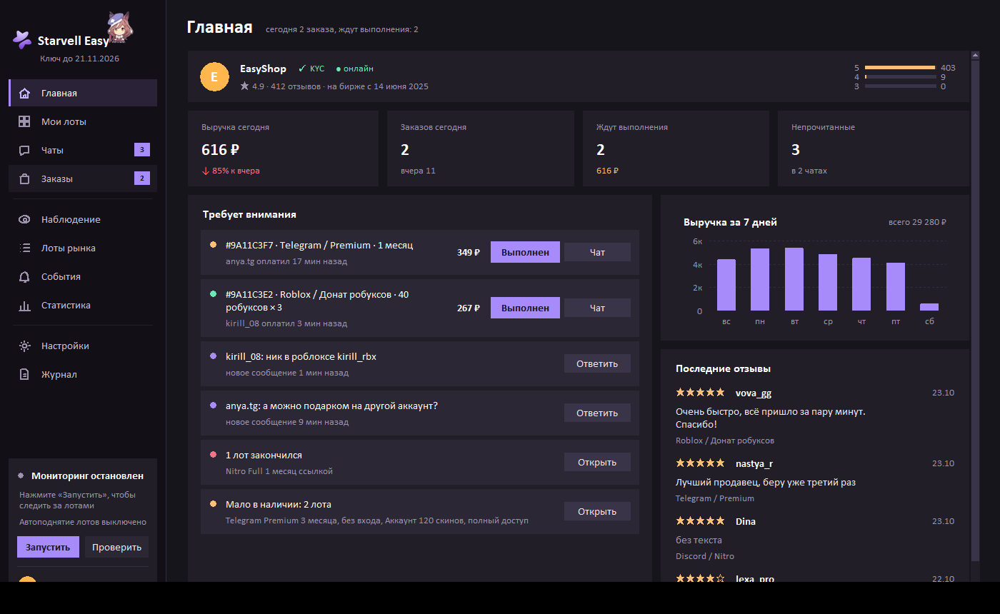
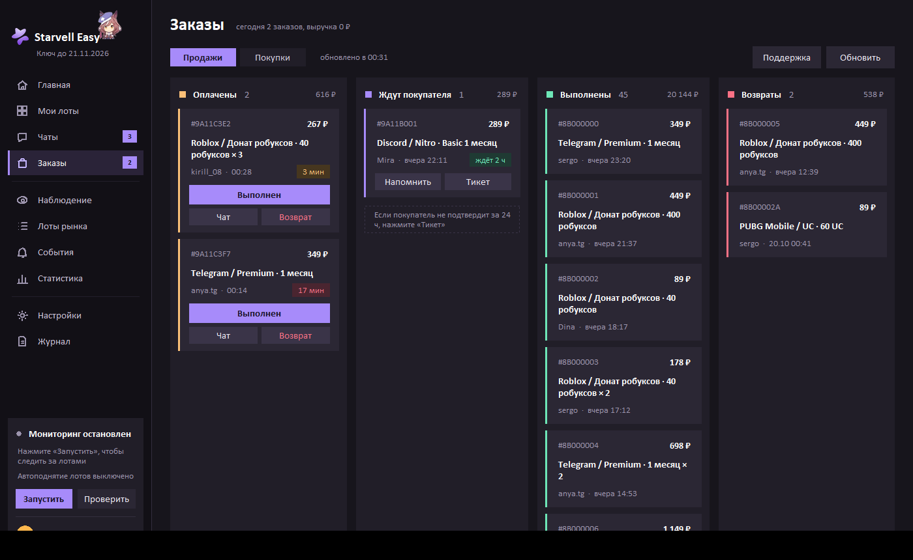
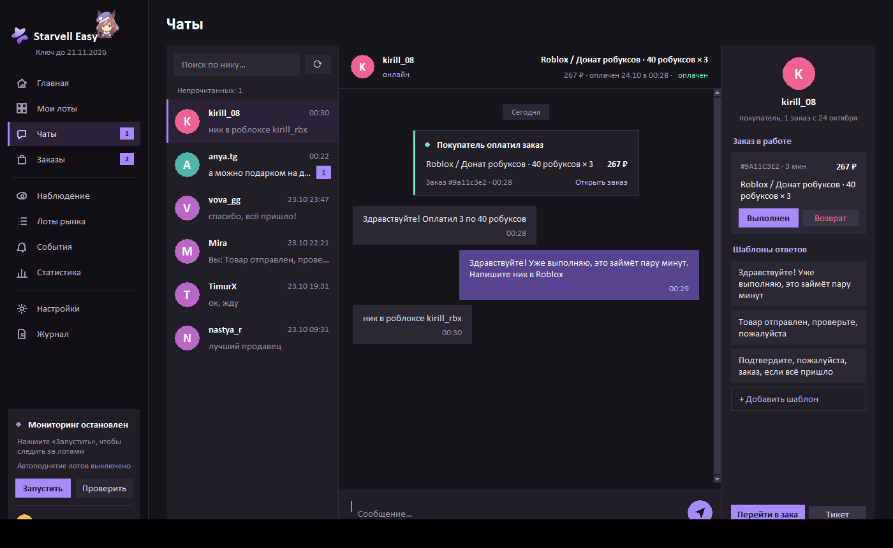
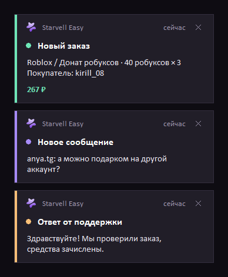
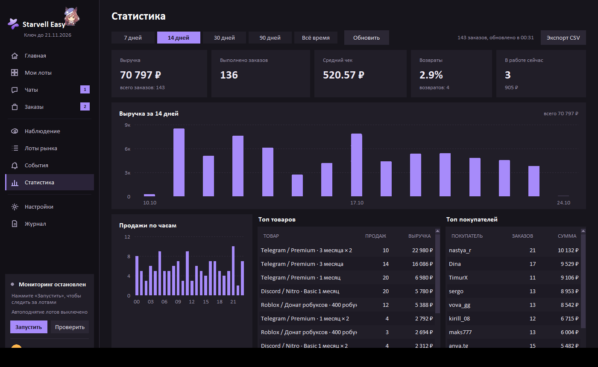
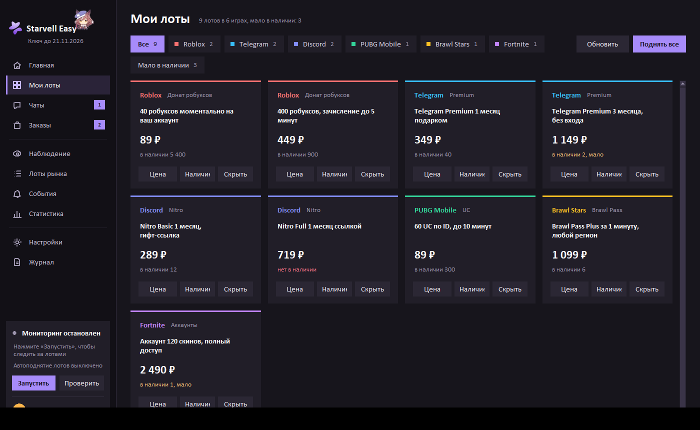
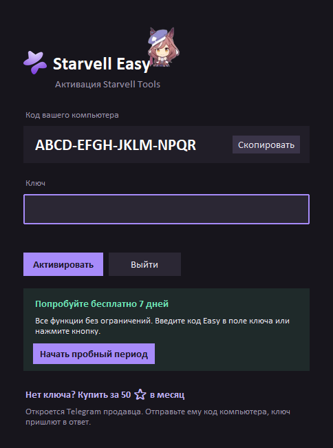

# Starvell Easy

**Программа для продавцов на [starvell.com](https://starvell.com).**
Заказы, чаты, лоты и выручка в одном окне — без вкладок браузера и постоянного обновления страницы.

**7 дней бесплатно** — код `Easy` в окне активации · дальше **50 ⭐ в месяц** · [@kk4ose](https://t.me/kk4ose)

[**Скачать StarvellTools.exe**](https://github.com/wxstarvell/Starvell.Easy/releases/latest)

## Почему продавцы ставят Starvell Easy

**Не пропустите ни одного заказа.** Новый заказ, сообщение покупателя или ответ поддержки всплывают окошком в углу экрана — даже когда программа свёрнута в трей. Никаких звуков и вечно открытой вкладки.

**Сразу видно, что делать.** «Главная» показывает выручку за сегодня, сколько заказов ждут выполнения, кто из покупателей не подтверждает заказ, какие лоты закончились и кому нужно ответить. Каждое дело — с кнопкой прямо в строке.

**Работает само.** Лоты поднимаются по расписанию, ночью могут скрываться и утром возвращаться. Программа стартует вместе с Windows и тихо сидит у часов.

## Возможности

### Заказы доской
«Оплачены → Ждут покупателя → Выполнены → Возвраты». Таймер показывает, сколько ждёт покупатель. Выполнить, вернуть, написать покупателю или открыть тикет в поддержку — одним кликом.

### Чаты как на сайте, только быстрее
Что купил человек, за сколько и когда оплатил — прямо в шапке чата. Фото от покупателей, карточки заказов в переписке, шаблоны ответов в один клик, кнопки «Выполнен» и «Возврат» рядом с перепиской.

### Уведомления
Новый заказ, новое сообщение, ответ поддержки, подтверждение, возврат, новый отзыв. Клик по уведомлению открывает нужный чат или заказ.

### Статистика
Выручка по дням и часам, средний чек, доля возвратов, топ товаров и покупателей, выгрузка в CSV.

### Мои лоты
Все лоты карточками: цена, наличие и скрытие лота в один клик, фильтр «мало в наличии».

### И ещё
- **Наблюдение за рынком:** новые лоты, изменения цен и наличия в выбранных категориях.
- **Автоподнятие** лотов и **расписание** скрытия на ночь.
- **Трей и автозапуск** с Windows — программа не мешает и всегда на связи.
- **Уведомления в Telegram** через своего бота — по желанию.
- Плавный тёмный интерфейс, окно ожидания при долгой загрузке и понятное сообщение, если сайт недоступен.

## Как начать

1. Скачайте `StarvellTools.exe` в разделе **[Releases](https://github.com/wxstarvell/Starvell.Easy/releases/latest)** и положите в отдельную папку — настройки и база будут храниться рядом с ним.
2. Запустите и нажмите **«Начать пробный период»** (или введите `Easy` в поле ключа). 7 дней, все функции без ограничений.
3. Войдите в аккаунт Starvell — программа подскажет, как.

## Покупка и продление

**50 ⭐ в месяц.** Telegram: [@kk4ose](https://t.me/kk4ose).

1. В окне активации нажмите **«Скопировать»** рядом с кодом компьютера.
2. Нажмите **«Нет ключа? Купить за 50 ⭐ в месяц»** — откроется Telegram. Отправьте код и оплатите.
3. Вставьте присланный ключ и нажмите **«Активировать»**.

Ключ действует 30 дней на одном компьютере. Чтобы продлить, напишите тот же код компьютера — новый ключ вводится по клику на строку «Ключ до …» под названием программы.

## Вопросы

**Это безопасно для аккаунта?**
Вход — через cookie `session` вашего браузера. Cookie хранится только у вас на компьютере (в `config.json` рядом с программой) и отправляется только на starvell.com. Программа работает обычными запросами к сайту, без управления браузером, и соблюдает паузы между запросами.

**Нужен ли Python или установка?**
Нет. Один файл `.exe`, ничего ставить не нужно.

**Можно на двух компьютерах?**
Один ключ — один компьютер. Для второго нужен отдельный ключ.

**Что-то не работает?**
Напишите в Telegram [@kk4ose](https://t.me/kk4ose) и приложите файл `logs/starvell_monitor.log` из папки программы.

---

Скриншоты сделаны на демо-данных. Starvell Easy — сторонняя программа, не связанная с администрацией Starvell.
